# SQL notes
> Учебная БД: PracticeDB. Скрипт создания — `init.sql`.
> Все запросы выполнялись в SSMS.
## Task 01 — Создание базы и таблиц

### SQL Запрос
```sql
-- =====================================================
-- init.sql — учебная БД PracticeDB
-- =====================================================
IF DB_ID('PracticeDB') IS NOT NULL
BEGIN
    ALTER DATABASE PracticeDB SET SINGLE_USER WITH ROLLBACK IMMEDIATE;
    DROP DATABASE PracticeDB;
END
GO
CREATE DATABASE PracticeDB;
GO
USE PracticeDB;
GO
CREATE TABLE Departments (
    DepartmentId   INT PRIMARY KEY IDENTITY(1,1),
    DepartmentName NVARCHAR(100) NOT NULL
);
CREATE TABLE Employees (
    EmployeeId   INT PRIMARY KEY IDENTITY(1,1),
    EmployeeName NVARCHAR(100) NOT NULL,
    Salary       DECIMAL(10,2) NOT NULL,
    HireDate     DATE NOT NULL,
    DepartmentId INT NOT NULL,
    ManagerId    INT NULL,
    CONSTRAINT FK_Employees_Departments FOREIGN KEY (DepartmentId)
        REFERENCES Departments(DepartmentId),
    CONSTRAINT FK_Employees_Manager FOREIGN KEY (ManagerId)
        REFERENCES Employees(EmployeeId)
);
CREATE TABLE Projects (
    ProjectId   INT PRIMARY KEY IDENTITY(1,1),
    ProjectName NVARCHAR(100) NOT NULL,
    StartDate   DATE NOT NULL
);
CREATE TABLE EmployeeProjects (
    EmployeeId INT NOT NULL,
    ProjectId  INT NOT NULL,
    Hours      INT NOT NULL DEFAULT 0,
    CONSTRAINT PK_EmployeeProjects PRIMARY KEY (EmployeeId, ProjectId),
    CONSTRAINT FK_EP_Employees FOREIGN KEY (EmployeeId) REFERENCES Employees(EmployeeId),
    CONSTRAINT FK_EP_Projects  FOREIGN KEY (ProjectId)  REFERENCES Projects(ProjectId)
);
GO
INSERT INTO Departments (DepartmentName) VALUES
    (N'Разработка'),
    (N'Аналитика'),
    (N'Тестирование'),
    (N'Менеджмент');
GO
INSERT INTO Employees (EmployeeName, Salary, HireDate, DepartmentId, ManagerId) VALUES
    (N'Анна Иванова',    65000, '2020-03-15', 1, NULL),
    (N'Пётр Сидоров',    72000, '2019-07-01', 1, NULL),
    (N'Мария Кузнецова', 55000, '2021-11-20', 1, NULL),
    (N'Иван Петров',     48000, '2023-02-10', 1, NULL),
    (N'Ольга Смирнова',  61000, '2020-09-05', 2, NULL),
    (N'Дмитрий Орлов',   58000, '2022-04-18', 2, NULL),
    (N'Елена Волкова',   52000, '2023-06-01', 2, NULL),
    (N'Сергей Морозов',  45000, '2021-12-12', 3, NULL),
    (N'Наталья Соколова',43000, '2024-01-15', 3, NULL),
    (N'Алексей Лебедев', 90000, '2018-05-25', 4, NULL);
GO
UPDATE Employees SET ManagerId = 1  WHERE EmployeeId = 4;
UPDATE Employees SET ManagerId = 2  WHERE EmployeeId = 3;
UPDATE Employees SET ManagerId = 5  WHERE EmployeeId = 6;
UPDATE Employees SET ManagerId = 10 WHERE EmployeeId = 9;
GO
INSERT INTO Projects (ProjectName, StartDate) VALUES
    (N'CRM System',      '2023-01-10'),
    (N'Mobile App',      '2023-05-01'),
    (N'Data Warehouse',  '2022-11-20'),
    (N'AI Assistant',    '2024-02-01'),
    (N'Legacy Refactor', '2021-06-15');
GO
INSERT INTO EmployeeProjects (EmployeeId, ProjectId, Hours) VALUES
    (1, 1, 120), (1, 3, 80),
    (2, 1, 150), (2, 4, 60),
    (3, 2, 100), (4, 2, 90),
    (4, 5, 40),  (5, 3, 110),
    (6, 3, 70),  (6, 4, 50),
    (7, 2, 95),  (8, 5, 130),
    (10, 4, 200),(10, 1, 30);
GO
```
### Результат
Проверка запросом SELECT на примере таблицы Departments

```sql
SELECT 
    DepartmentId,DepartmentName
FROM Departments
```
Результат:

| DepartmentId | DepartmentName |
|:----:|:----:|
|1|	Разработка|
|2|	Аналитика|
|3|	Тестирование|
|4|	Менеджмент|

### Вывод

Здесь я уздал, как удобно создать базу данных одним запросом


## Task 02 — INSERT: заполнение данными

### SQL Запрос
```sql
INSERT INTO Departments (DepartmentName) VALUES
    (N'Разработка'),
    (N'Аналитика'),
    (N'Тестирование'),
    (N'Менеджмент');
GO
INSERT INTO Employees (EmployeeName, Salary, HireDate, DepartmentId, ManagerId) VALUES
    (N'Анна Иванова',    65000, '2020-03-15', 1, NULL),
    (N'Пётр Сидоров',    72000, '2019-07-01', 1, NULL),
    (N'Мария Кузнецова', 55000, '2021-11-20', 1, NULL),
    (N'Иван Петров',     48000, '2023-02-10', 1, NULL),
    (N'Ольга Смирнова',  61000, '2020-09-05', 2, NULL),
    (N'Дмитрий Орлов',   58000, '2022-04-18', 2, NULL),
    (N'Елена Волкова',   52000, '2023-06-01', 2, NULL),
    (N'Сергей Морозов',  45000, '2021-12-12', 3, NULL),
    (N'Наталья Соколова',43000, '2024-01-15', 3, NULL),
    (N'Алексей Лебедев', 90000, '2018-05-25', 4, NULL);
GO
UPDATE Employees SET ManagerId = 1  WHERE EmployeeId = 4;
UPDATE Employees SET ManagerId = 2  WHERE EmployeeId = 3;
UPDATE Employees SET ManagerId = 5  WHERE EmployeeId = 6;
UPDATE Employees SET ManagerId = 10 WHERE EmployeeId = 9;
GO
INSERT INTO Projects (ProjectName, StartDate) VALUES
    (N'CRM System',      '2023-01-10'),
    (N'Mobile App',      '2023-05-01'),
    (N'Data Warehouse',  '2022-11-20'),
    (N'AI Assistant',    '2024-02-01'),
    (N'Legacy Refactor', '2021-06-15');
GO
INSERT INTO EmployeeProjects (EmployeeId, ProjectId, Hours) VALUES
    (1, 1, 120), (1, 3, 80),
    (2, 1, 150), (2, 4, 60),
    (3, 2, 100), (4, 2, 90),
    (4, 5, 40),  (5, 3, 110),
    (6, 3, 70),  (6, 4, 50),
    (7, 2, 95),  (8, 5, 130),
    (10, 4, 200),(10, 1, 30);
GO
```
Запрос проверки
```sql
SELECT 'Departments' AS TableName, COUNT(*) AS STRING FROM Departments
UNION ALL
SELECT 'Employees', COUNT(*) FROM Employees
UNION ALL
SELECT 'Projects', COUNT(*) FROM Projects
UNION ALL
SELECT 'EmployeeProjects', COUNT(*) FROM EmployeeProjects;
```
### Результат
|TableName|STRING|
|:----:|:----:|
|Departments	|4|
|Employees	|10|
|Projects	|5|
|EmployeeProjects|	14|
### Вывод
Получено общее представление о вводе информации и выводе её из нужной таблицы


## Task 03 — SELECT + WHERE: базовые выборки

### SQL Запрос
```sql
SELECT EmployeeId, EmployeeName, Salary 
FROM Employees 
WHERE Salary > 50000;


SELECT EmployeeId, EmployeeName, HireDate 
FROM Employees 
WHERE YEAR(HireDate) = 2023;

SELECT EmployeeId, EmployeeName 
FROM Employees 
WHERE EmployeeName LIKE 'А%';


SELECT EmployeeId, EmployeeName, DepartmentId 
FROM Employees 
WHERE DepartmentId = 2;


SELECT EmployeeId, EmployeeName, Salary 
FROM Employees 
WHERE Salary BETWEEN 40000 AND 60000;
```
### Результат
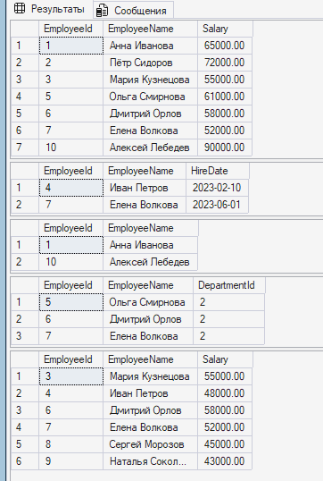
### Вывод
Получено общее представление о выводе конкретной информации из нужной таблицы


## Task 04 — ORDER BY + TOP: сортировка и лимит

### SQL Запрос
```sql

SELECT TOP 3 EmployeeId, EmployeeName, Salary 
FROM Employees 
ORDER BY Salary DESC;


SELECT TOP 5 EmployeeId, EmployeeName, HireDate 
FROM Employees 
ORDER BY HireDate ASC;


SELECT EmployeeId, EmployeeName, DepartmentId, Salary 
FROM Employees 
ORDER BY DepartmentId ASC, Salary DESC;
```
### Результат
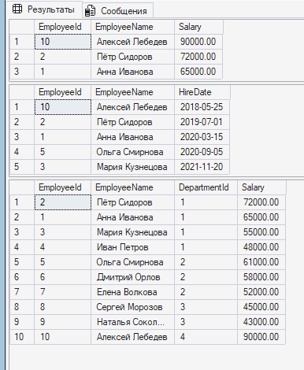
### Вывод
Получено общее представление о выводе топа конкретных значений


## Task 05 — Агрегация: COUNT, SUM, AVG, MIN, MAX

### SQL Запрос
```sql
SELECT 
    COUNT(*) AS Всего_сотрудников,
    SUM(Salary) AS Сумма_зарплат,
    ROUND(AVG(Salary), 2) AS Средняя_зарплата,
    MIN(Salary) AS Мин_зп,
    MAX(Salary) AS Макс_зп,
    SUM(CASE WHEN Salary > 50000 THEN 1 ELSE 0 END) AS Количество_человек_с_зп_больше_50к
FROM Employees;
```
### Результат
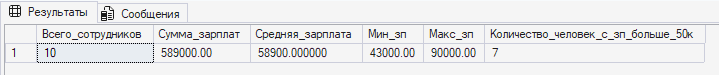
### Вывод
Получено общее представление о выводе подсчётов


## Task 06 — GROUP BY: статистика по отделам

### SQL Запрос
```sql
SELECT 
    DepartmentId AS [Код отдела],
    COUNT(*) AS [Количество сотрудников],
    AVG(Salary) AS [Средняя зарплата],
    SUM(Salary) AS [Суммарная зарплата]
FROM Employees
GROUP BY DepartmentId
ORDER BY [Средняя зарплата] DESC;
```
### Результат
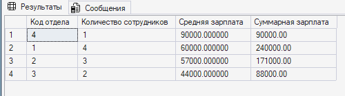
### Вывод
Получено представление о выводе верной группировке и сортировке 


## Task 07 — GROUP BY + HAVING: фильтрация групп

### SQL Запрос
```sql

SELECT 
    DepartmentId AS [Код отдела],
    COUNT(*) AS [Количество сотрудников]
FROM Employees
GROUP BY DepartmentId
HAVING COUNT(*) > 2;


SELECT 
    DepartmentId AS [Код отдела],
    AVG(Salary) AS [Средняя зарплата]
FROM Employees
GROUP BY DepartmentId
HAVING AVG(Salary) > 55000;


SELECT 
    DepartmentId AS [Код отдела],
    SUM(Salary) AS [Суммарная зарплата]
FROM Employees
GROUP BY DepartmentId
HAVING SUM(Salary) > 150000;
```
### Результат
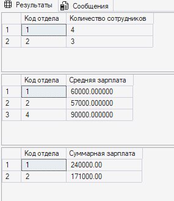
### Вывод
Получено представление о фильтрации групп


## Task 08 — INNER JOIN: сотрудники и отделы

### SQL Запрос
```sql
SELECT 
    e.EmployeeName AS [Сотрудник],
    d.DepartmentName AS [Отдел],
    e.Salary AS [Зарплата]
FROM Employees e
INNER JOIN Departments d ON e.DepartmentId = d.DepartmentId
ORDER BY d.DepartmentName ASC, e.Salary DESC;
```
### Результат
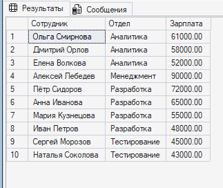
### Вывод
Получено представление о объединении таблиц


## Task 09 — LEFT JOIN: сотрудники без проектов

### SQL Запрос
```sql
SELECT 
    e.EmployeeId AS EmployeeId,
    e.EmployeeName AS EmployeeName
FROM Employees e
LEFT JOIN EmployeeProjects ep ON e.EmployeeId = ep.EmployeeId
WHERE ep.EmployeeId IS NULL;
```
### Результат
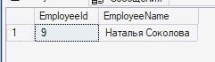
### Вывод
Получено представление о поиске записей в одной таблице, у которых нет связей в другой


## Task 10 — Множественный JOIN: сотрудники, отделы, проекты

### SQL Запрос
```sql
SELECT 
    e.EmployeeName AS [Имя сотрудника],
    d.DepartmentName AS [Название отдела],
    p.ProjectName AS [Название проекта],
    ep.Hours AS [Количество часов]
FROM Employees e
INNER JOIN Departments d ON e.DepartmentId = d.DepartmentId
INNER JOIN EmployeeProjects ep ON e.EmployeeId = ep.EmployeeId
INNER JOIN Projects p ON ep.ProjectId = p.ProjectId
ORDER BY 
    d.DepartmentName ASC, 
    e.EmployeeName ASC, 
    p.ProjectName ASC;
```
### Результат
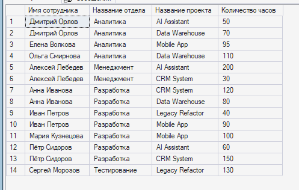
### Вывод
Закрепление всех знаний уровня


## Task 11 — Self-join: иерархия руководителей

### SQL Запрос
```sql
SELECT 
    e.EmployeeName AS [Сотрудник],
    m.EmployeeName AS [Руководитель]
FROM Employees e
LEFT JOIN Employees m ON e.ManagerId = m.EmployeeId
ORDER BY m.EmployeeName DESC, e.EmployeeName;
```
### Результат
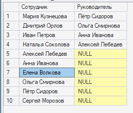
### Вывод
Разобрался в конструкции SELF JOIN


## Task 12 — Подзапросы в WHERE

### SQL Запрос
```sql
SELECT 
    EmployeeName AS [Сотрудник], 
    Salary AS [Зарплата]
FROM Employees
WHERE Salary > (SELECT AVG(Salary) FROM Employees);

SELECT 
    EmployeeName AS [Сотрудник], 
    Salary AS [Зарплата]
FROM Employees
WHERE Salary = (SELECT MAX(Salary) FROM Employees);
```
### Результат
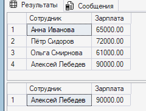
### Вывод
Понял как делать подзапросы в условии


## Task 13 — Скалярные подзапросы в SELECT

### SQL Запрос
```sql
SELECT 
    e.EmployeeName AS [Сотрудник],
    e.Salary AS [Зарплата],
    e.DepartmentId AS [Код отдела],
    ROUND(
        e.Salary - (SELECT AVG(Salary) FROM Employees WHERE DepartmentId = e.DepartmentId), 
        2
    ) AS [Отклонение от средней по отделу]
FROM Employees e
ORDER BY e.DepartmentId, e.EmployeeName;
```
### Результат
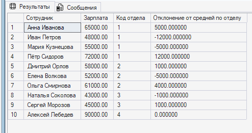
### Вывод
Получено представление о скалярных запросах SELECT


## Task 14 — EXISTS / NOT EXISTS
### SQL Запрос
```sql
SELECT 
    e.EmployeeName AS [Сотрудник]
FROM Employees e
WHERE EXISTS (
    SELECT 1 
    FROM EmployeeProjects ep 
    WHERE ep.EmployeeId = e.EmployeeId
);

SELECT 
    e.EmployeeName AS [Сотрудник]
FROM Employees e
WHERE NOT EXISTS (
    SELECT 1 
    FROM EmployeeProjects ep 
    WHERE ep.EmployeeId = e.EmployeeId
);
```
### Результат
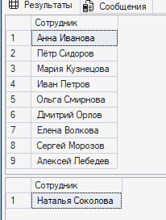
### Вывод
Получено представление о запросах EXISTS / NOT EXISTS


## Task 15 — UNION / UNION ALL

### SQL Запрос
```sql
-- UNION 
SELECT EmployeeName AS [Сотрудник], Salary AS [Зарплата], HireDate AS [Дата найма], 'Высокая ЗП' AS [Причина]
FROM Employees
WHERE Salary > 60000
UNION
SELECT EmployeeName, Salary, HireDate, 'Старый сотрудник'
FROM Employees
WHERE HireDate < '2022-01-01';

-- UNION ALL 
SELECT EmployeeName AS [Сотрудник], Salary AS [Зарплата], HireDate AS [Дата найма], 'Высокая ЗП' AS [Причина]
FROM Employees
WHERE Salary > 60000
UNION ALL
SELECT EmployeeName, Salary, HireDate, 'Старый сотрудник'
FROM Employees
WHERE HireDate < '2022-01-01';

-- сравнение
SELECT COUNT(*) AS [Кол-во строк UNION]
FROM (
    SELECT EmployeeId FROM Employees WHERE Salary > 60000
    UNION
    SELECT EmployeeId FROM Employees WHERE HireDate < '2022-01-01'
) t;

SELECT COUNT(*) AS [Кол-во строк UNION ALL]
FROM (
    SELECT EmployeeId FROM Employees WHERE Salary > 60000
    UNION ALL
    SELECT EmployeeId FROM Employees WHERE HireDate < '2022-01-01'
) t;
```
### Результат
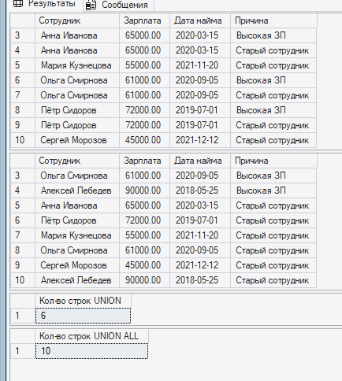
### Вывод
Получено представление о запросах UNION / UNION ALL


## Task 16 — UPDATE: изменение данных

### SQL Запрос
```sql
SELECT EmployeeId, EmployeeName, Salary AS [ЗП До] FROM Employees WHERE DepartmentId = 1;

UPDATE Employees 
SET Salary = Salary * 1.10 
WHERE DepartmentId = 1;

SELECT EmployeeId, EmployeeName, Salary AS [ЗП После] FROM Employees WHERE DepartmentId = 1;


UPDATE Employees 
SET Salary = Salary + 5000 
WHERE HireDate < '2022-01-01';


SELECT EmployeeId, EmployeeName, HireDate AS [Дата До] FROM Employees WHERE EmployeeId = 4;

UPDATE Employees 
SET HireDate = '2023-03-01' 
WHERE EmployeeId = 4;

SELECT EmployeeId, EmployeeName, HireDate AS [Дата После] FROM Employees WHERE EmployeeId = 4;
```
### Результат
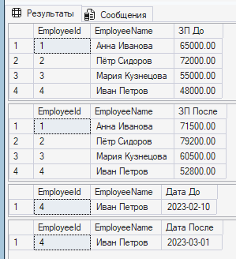
### Вывод
Получено представление о запросах обновления данных


## Task 17 — DELETE: удаление данных

### SQL Запрос
```sql
SELECT COUNT(*) AS [Назначений с 0 часов] FROM EmployeeProjects WHERE Hours = 0;
DELETE FROM EmployeeProjects WHERE Hours = 0;
SELECT COUNT(*) AS [Осталось с 0 часов] FROM EmployeeProjects WHERE Hours = 0;


SELECT COUNT(*) AS [Всего сотрудников] FROM Employees;

DELETE FROM EmployeeProjects WHERE EmployeeId = 9;
DELETE FROM Employees WHERE EmployeeId = 9;

SELECT COUNT(*) AS [Осталось сотрудников] FROM Employees;


SELECT * INTO #TempTable FROM EmployeeProjects;
SELECT COUNT(*) AS [В копии До] FROM #TempTable;

DELETE FROM #TempTable; -- Без WHERE (удаляет всё)

SELECT COUNT(*) AS [В копии После] FROM #TempTable;
DROP TABLE #TempTable;
```
### Результат
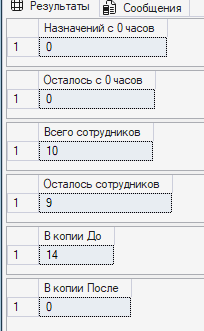
### Вывод
Получено представление о запросах удаления данных


## Task 18 — BEGIN TRAN / COMMIT / ROLLBACK

### SQL Запрос
```sql
BEGIN TRY
    -- 1. ТЕСТ ROLLBACK
    BEGIN TRANSACTION;
    
    SELECT EmployeeName AS [Имя], Salary AS [ЗП Исходная] FROM Employees WHERE EmployeeId = 1;
    
    UPDATE Employees SET Salary = 999999 WHERE EmployeeId = 1;
    
    SELECT EmployeeName AS [Имя], Salary AS [ЗП Внутри транзакции] FROM Employees WHERE EmployeeId = 1;
    
    ROLLBACK TRANSACTION;
    PRINT '--- Выполнен ROLLBACK ---';
    
    SELECT EmployeeName AS [Имя], Salary AS [ЗП После ROLLBACK] FROM Employees WHERE EmployeeId = 1;

    -- 2. ТЕСТ COMMIT
    BEGIN TRANSACTION;
    
    UPDATE Employees SET Salary = 70000 WHERE EmployeeId = 1;
    
    SELECT EmployeeName AS [Имя], Salary AS [ЗП Внутри 2-й транзакции] FROM Employees WHERE EmployeeId = 1;
    
    COMMIT TRANSACTION;
    PRINT '--- Выполнен COMMIT ---';
    
    SELECT EmployeeName AS [Имя], Salary AS [ЗП После COMMIT] FROM Employees WHERE EmployeeId = 1;
END TRY
BEGIN CATCH
    IF @@TRANCOUNT > 0 ROLLBACK TRANSACTION;
    PRINT 'Ошибка: ' + ERROR_MESSAGE();
END CATCH;
```
### Результат
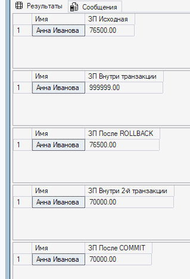
### Вывод
Получено представление о транзакциях, print комменты выводятся в сообщениях, в выводе их нет


## Task 19 — Представления (VIEW)

### SQL Запрос
```sql
CREATE VIEW vw_EmployeeDetails AS
SELECT 
    e.EmployeeName AS [Сотрудник],
    d.DepartmentName AS [Отдел],
    p.ProjectName AS [Проект],
    ep.Hours AS [Часы]
FROM Employees e
INNER JOIN Departments d ON e.DepartmentId = d.DepartmentId
INNER JOIN EmployeeProjects ep ON e.EmployeeId = ep.EmployeeId
INNER JOIN Projects p ON ep.ProjectId = p.ProjectId;
GO


SELECT * FROM vw_EmployeeDetails;


DROP VIEW vw_EmployeeDetails;
```
### Результат
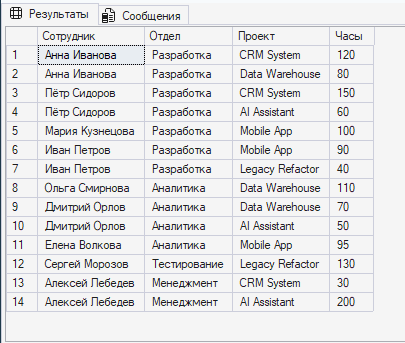
### Вывод
Получено представление о представлениях view


## Task 20 — 

### SQL Запрос
```sql
SET STATISTICS IO ON;
GO

SELECT * FROM Employees 
WHERE DepartmentId = 1 AND Salary > 50000;
GO

CREATE INDEX IX_Employees_DepartmentId ON Employees(DepartmentId);
CREATE INDEX IX_Employees_Salary ON Employees(Salary);
GO

SELECT * FROM Employees 
WHERE DepartmentId = 1 AND Salary > 50000;
GO

SET STATISTICS IO OFF;
GO
```
### Результат
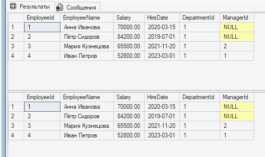
### Вывод
Получено представление о индексации
